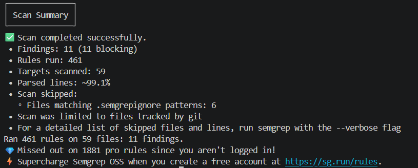
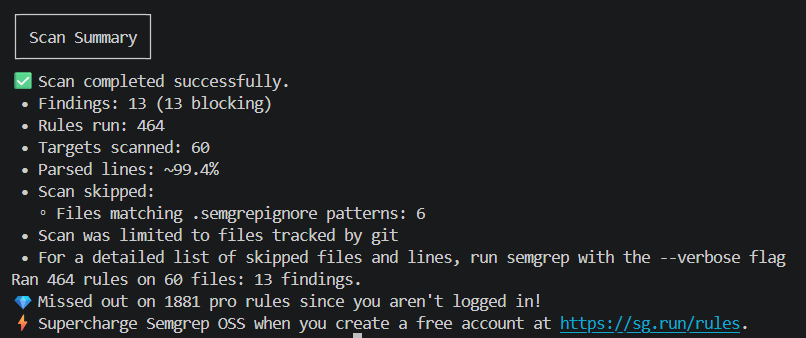
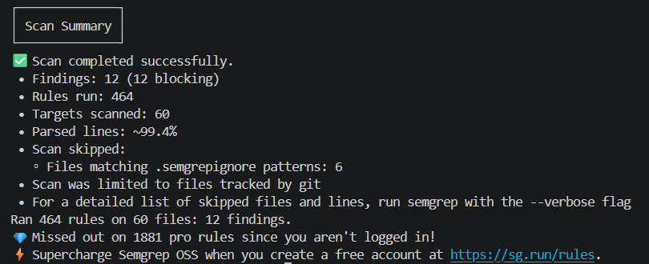

# Write-up — Práctica 6: Análisis estático de código (SAST)

**Materia:** Desarrollo de Software Seguro

**Autor:** Gaston Grane

**Fecha:** 09/11/2026

> **Disclaimer:** Tanto la instalación de la herramienta como la ejecución de los escaneos los hice yo, en mi propia máquina Windows (no en la VM de los prácticos anteriores, ya que el análisis estático no necesita que nada esté corriendo, ni Docker ni la app en sí, solo lee el código fuente directamente). Conté con asistencia de una herramienta de IA para interpretar los resultados y redactar este informe.

---

## Índice

1. [Herramienta elegida y por qué](#herramienta-elegida-y-por-qué)
2. [Cómo funciona Semgrep](#cómo-funciona-semgrep)
3. [Limitaciones de la edición Community](#limitaciones-de-la-edición-community)
4. [Ejecución y resultados](#ejecución-y-resultados)
5. [Análisis de falsos positivos y falsos negativos](#análisis-de-falsos-positivos-y-falsos-negativos)
6. [Diferencias entre ramas](#diferencias-entre-ramas)
7. [Comparación con revisión de código por LLM](#comparación-con-revisión-de-código-por-llm)
8. [Conclusión](#conclusión)

---

## Herramienta elegida y por qué

Elegí **Semgrep Community Edition** en vez de SonarQube Community Build. La razón principal es práctica: Semgrep es un programa de línea de comandos que se instala con un simple `pip install semgrep` y corre directo sobre el código, sin necesitar nada más. SonarQube en cambio requiere levantar un servidor completo (con su propia base de datos) y después correr un scanner aparte que le mande los resultados, lo cual agrega bastante complejidad de infraestructura para lo que necesitaba este práctico. Dado que ya tuvimos bastante trabajo con Docker/Maven en los prácticos anteriores, Semgrep me permitió enfocarme en el análisis en sí, no en armar el ambiente.

## Cómo funciona Semgrep

Semgrep analiza el código fuente comparándolo contra un conjunto de **reglas** (rules), cada una escrita para detectar un patrón específico de código potencialmente inseguro, sin necesidad de ejecutar el programa. Internamente arma algo parecido a lo que vimos en clase sobre Abstract Syntax Trees: parsea el código, entiende su estructura, y busca coincidencias entre esa estructura y los patrones definidos en cada regla.

Cada regla identifica un lenguaje (Java, Python, Dockerfile, etc.) y un patrón de código a buscar, acompañado de una explicación de por qué ese patrón es riesgoso y, en algunos casos, una sugerencia de cómo arreglarlo ("Autofix"). El comando que usé, `semgrep scan --config=auto`, hace que Semgrep detecte automáticamente qué lenguajes hay en el proyecto y aplique el conjunto de reglas "Community" relevantes para esos lenguajes, bajándolas desde su registro público (Semgrep Registry) en el momento de correr.

## Limitaciones de la edición Community

Al correr el escaneo, Semgrep mismo muestra explícitamente qué le falta a la edición gratuita, comparado con lo que ofrece si te logueás (gratis igual, pero con más reglas) o pagás un plan comercial:

```
✔ Semgrep OSS
  ✔ Basic security coverage for first-party code vulnerabilities.

✘ Semgrep Code (SAST)
  ✘ Find and fix vulnerabilities in the code you write with advanced scanning and expert security rules.

✘ Semgrep Supply Chain (SCA)
  ✘ Find and fix the reachable vulnerabilities in your OSS dependencies.

💎 Missed out on 1881 pro rules since you aren't logged in!
```

Dicho de otra manera, la edición Community (lo que usé, sin loguearme) corrió **461 reglas**. Pero el propio cartel dice que hay **1881 reglas adicionales** ("pro rules") que no se aplicaron, pertenecientes a dos productos pagos/con cuenta:

- **Semgrep Code (SAST):** reglas "avanzadas" y "de expertos en seguridad", presumiblemente con análisis más profundo (más parecido al análisis de flujo de datos entre funciones que vimos en la clase, en vez de solo mirar patrones locales).
- **Semgrep Supply Chain (SCA):** análisis de las **dependencias** del proyecto (librerías de terceros), que la edición Community directamente no cubre. O sea que, aunque mi código propio esté limpio, una librería vulnerable que esté usando el proyecto (Flask, Spring Boot, etc.) no se analizaría en absoluto con la edición gratuita.

Esto coincide con lo que vimos en la presentación de la clase sobre las limitaciones generales del análisis estático: las herramientas Community/gratuitas suelen tener rulesets más chicos y un alcance de análisis más limitado (local/modular en vez de global), lo cual se traduce directamente en más falsos negativos, como voy a mostrar más abajo.

## Ejecución y resultados

Instalé Semgrep con:

```bash
pip install semgrep
```

Y corrí el escaneo parado en la raíz del repo, una vez en cada rama:

```bash
git checkout main
semgrep scan --config=auto
```

```bash
git checkout practico-2
semgrep scan --config=auto
```

### Resultados en `main`

```
Ejercicio1\Dockerfile
❯❯❱ dockerfile.security.missing-user.missing-user
    By not specifying a USER, a program in the container may run as 'root'.

Ejercicio2\Dockerfile
❯❯❱ dockerfile.security.missing-user.missing-user
    (mismo hallazgo)

Ejercicio3\Dockerfile
❯❯❱ dockerfile.security.missing-user-entrypoint.missing-user-entrypoint
    (mismo hallazgo)

Ejercicio3\src\main\resources\templates\upload.html
❯❱ python.django.security.django-no-csrf-token.django-no-csrf-token
    Manually-created forms in django templates should specify a csrf_token.

Ejercicio4\Dockerfile
❯❯❱ dockerfile.security.missing-user-entrypoint.missing-user-entrypoint
    (mismo hallazgo)

Ejercicio4\src\main\java\com\cinebuscador\config\SpelEvaluator.java
❯❱ java.spring.security.audit.spel-injection.spel-injection
    A Spring expression is built with a dynamic value.

Ejercicio5\Dockerfile
❯❯❱ dockerfile.security.missing-user-entrypoint.missing-user-entrypoint
    (mismo hallazgo)

Ejercicio5\src\main\java\com\cinebuscador\config\EncryptionService.java
❯❱ java.lang.security.audit.crypto.use-of-aes-ecb.use-of-aes-ecb
    Use of AES with ECB mode detected.

Ejercicio5\src\main\resources\templates\index.html
❯❱ python.django.security.django-no-csrf-token.django-no-csrf-token
    (mismo hallazgo, 2 formularios)

Scan Summary: 11 findings, 461 rules run, 59 targets scanned.
```



### Resultados en `practico-2`

```
(los mismos 9 hallazgos de arriba, salvo uno)

- YA NO aparece: Ejercicio5\EncryptionService.java (use-of-aes-ecb)
  → correcto, porque borré ese archivo al aplicar la mitigación.

- SIGUE apareciendo: Ejercicio4\SpelEvaluator.java (spel-injection)
  → la clase sigue existiendo en el repo, aunque ya no se usa.

NUEVO:
Practico2.md
❯❯❱ generic.secrets.security.detected-bcrypt-hash.detected-bcrypt-hash
    bcrypt hash detected (en los hashes que pegué como evidencia de la PoC del Ejercicio 5)

README.md
❯❯❱ generic.secrets.security.detected-bcrypt-hash.detected-bcrypt-hash
    (mismo hallazgo, mismo contenido duplicado en el README)

Scan Summary: 13 findings, 464 rules run, 60 targets scanned.
```



## Análisis de falsos positivos y falsos negativos

Antes de entrar en detalle, repaso las definiciones que vimos en clase: un **falso positivo** es cuando la herramienta marca algo como problema y en realidad no lo es (complica la revisión, pero no es un riesgo real). Un **falso negativo** es cuando hay una vulnerabilidad real y la herramienta no la detecta (sí es un riesgo real, porque nadie se entera).

Comparando los 11/13 hallazgos contra las 5 vulnerabilidades reales que ya identifiqué y mitigué a mano en el Práctico 2:

| Vulnerabilidad real | ¿La detectó Semgrep? |
|---|---|
| Ejercicio 1 — SQLi | ❌ Falso negativo. No apareció ningún hallazgo sobre la concatenación de `query` en el SQL. |
| Ejercicio 2 — XSS (`\| safe`) | ❌ Falso negativo. No detectó el filtro `\| safe` de Jinja2 desactivando el auto-escape. |
| Ejercicio 3 — File Upload | ❌ Falso negativo. No detectó que se guarda el archivo con el nombre/extensión que manda el cliente sin validar. |
| Ejercicio 4 — SSTI (SpEL) | ✅ Verdadero positivo (`spel-injection`). |
| Ejercicio 5 — Almacenamiento inseguro | ⚠️ Parcial. Detectó el modo ECB (`use-of-aes-ecb`), pero **no** detectó que la clave de cifrado está hardcodeada en el código fuente (`SECRET_KEY = "MySup3rS3cr3tK3y!..."`), que era la otra mitad del problema. |

O sea: de 5 vulnerabilidades reales, el ruleset por defecto solo detectó **1 completa** (el SSTI) y **1 a medias** (el ECB del Ejercicio 5, sin la clave hardcodeada), dejando pasar **3 por completo** (SQLi, XSS y File Upload). Esto confirma lo que dice la teoría: un analizador estático detecta patrones conocidos y predefinidos, no "entiende" el código como lo haría una persona (o un LLM, como muestro más abajo). Que el ruleset no tenga una regla específica para "SQL armado con f-strings en SQLite/Flask" o para "filtro `| safe` de Jinja2 sobre datos de usuario" significa que esos patrones, aunque sean errores de seguridad clásicos y muy conocidos, simplemente no están cubiertos por el conjunto de reglas gratuitas que corrí.

**Falsos positivos encontrados:**

- `python.django.security.django-no-csrf-token` disparó **3 veces** (Ejercicio3/upload.html, y 2 formularios en Ejercicio5/index.html), en ambas ramas. Es un falso positivo claro: esta regla está pensada para proyectos **Django** (un framework de Python), pero el proyecto usa **Thymeleaf** (plantillas de Java/Spring). La regla hace un matcheo genérico sobre cualquier `<form method="post">` sin un token CSRF visible en el HTML, sin verificar realmente si el proyecto usa Django. Como consecuencia, dispara en cualquier formulario HTML simple, sin importar el framework real.
- `generic.secrets.security.detected-bcrypt-hash` disparó **2 veces** en `practico-2`, pero sobre `Practico2.md` y `README.md`, no sobre código fuente. Son los hashes de BCrypt que pegué como evidencia de la PoC del Ejercicio 5 (`$2a$10$...`). Técnicamente la regla "acierta" en el sentido de que ese string tiene la forma exacta de un hash BCrypt real, pero no es un secreto filtrado de verdad: es documentación de una prueba de concepto con usuarios de prueba descartables, no una credencial de producción. Lo cuento como falso positivo en el sentido práctico (no representa un riesgo real), aunque técnicamente el patrón sí coincide.

**Hallazgos reales, pero fuera del alcance de las 5 vulnerabilidades trabajadas:**

- `dockerfile.security.missing-user` / `missing-user-entrypoint`, en los 5 Dockerfiles, en ambas ramas. Es un hallazgo legítimo (los contenedores corren como root, lo cual es mala práctica de hardening), pero no tiene nada que ver con ninguna de las 5 vulnerabilidades de CWE que trabajé en el Práctico 2. Lo dejo anotado como mejora pendiente, fuera del alcance de este práctico.

## Diferencias entre ramas

Entre `main` (11 hallazgos) y `practico-2` (13 hallazgos), lo esperable sería ver una baja en los hallazgos reales (porque mitigué 5 vulnerabilidades), pero el número en realidad **subió**. Esto se explica así:

- **Bajó 1 hallazgo real:** el de `use-of-aes-ecb` desaparece correctamente en `practico-2`, porque borré por completo `EncryptionService.java` al migrar a BCrypt. Acá Semgrep reflejó bien el fix.
- **Se mantuvo 1 hallazgo que ya no debería estar:** `spel-injection` sigue apareciendo en `practico-2`, a pesar de que la vulnerabilidad real está mitigada (saqué la llamada a `spelEval.evaluate(buscar)` del controller). El motivo es que **nunca borré el archivo `SpelEvaluator.java`**, solo dejó de usarse. Semgrep analiza esa función de forma aislada, sin verificar si alguien la sigue llamando con datos de usuario — lo que en la clase vimos como "análisis local" (función por función, sin relación entre ellas), la opción con menor alcance y más propensa a este tipo de desajuste. Un análisis con mayor alcance (modular o global, que rastree si esa función se sigue invocando desde algún lado) probablemente no marcaría esto, porque vería que ya no hay ningún llamador pasándole datos de usuario. Es un ejemplo perfecto de la diferencia entre "el patrón de código peligroso existe" y "el patrón de código peligroso es explotable en este momento". Semgrep solo puede afirmar lo primero con su alcance actual.
- **Sumaron 2 hallazgos nuevos**, ninguno relacionado al código de la app: los de "bcrypt hash detected" sobre el propio informe del Práctico 2, que no existían en `main` porque ese archivo (`Practico2.md`) solo se subió en `practico-2`.

En limpio: la comparación numérica de "cuántos hallazgos totales" (11 vs. 13) es engañosa si se la lee sin contexto, sugiere que `practico-2` está "peor", cuando en realidad el único cambio real de seguridad (el ECB) mejoró, y el resto del incremento son ruido (documentación con hashes de prueba) o una limitación conocida de la herramienta (código muerto todavía detectado). Esto refuerza un punto central de la clase: los resultados de una herramienta SAST **necesitan revisión humana** para interpretarse correctamente, no alcanza con mirar el número de hallazgos.

Resumido en una tabla, los 4 tipos de hallazgo que aparecen se comportan así entre ramas:

| Tipo de hallazgo | ¿Cambia entre ramas? |
|---|---|
| Dockerfile sin USER (5 archivos) | No, igual en las dos (no relacionado a las 5 vulnerabilidades) |
| CSRF de Django (falso positivo) | No, igual en las dos (no relacionado a las 5 vulnerabilidades) |
| ECB en EncryptionService.java | Sí, desaparece correctamente en `practico-2` |
| SpelEvaluator.java (SSTI) | Seguía igual hasta que borré el archivo manualmente (ver más abajo) |

### Acción tomada a partir de este hallazgo

Como el hallazgo de `spel-injection` sobre `SpelEvaluator.java` resultó ser, en la práctica, código muerto (la clase ya no la llama nadie desde que mitigué el Ejercicio 4), decidí borrar el archivo directamente en vez de dejarlo dando vueltas. No había ninguna razón para conservarlo: ya no cumplía ninguna función en la app.

```bash
Remove-Item Ejercicio4\src\main\java\com\cinebuscador\config\SpelEvaluator.java
semgrep scan --config=auto
```

Resultado: los hallazgos bajaron de 13 a **12**, y el `spel-injection` ya no aparece en la lista.



Esto es un buen ejemplo de para qué sirve realmente este tipo de herramienta: no solo para encontrar vulnerabilidades activas, sino también para detectar código riesgoso que quedó abandonado y que en el futuro alguien podría volver a conectar sin darse cuenta del peligro que tiene adentro.

## Comparación con revisión de código por LLM

Además del escaneo con Semgrep, le pedí a un LLM (Claude Code) que revisara el código fuente de `main` buscando vulnerabilidades, sin decirle de antemano cuáles eran. Esto permite comparar directamente las dos formas de análisis estático: por reglas predefinidas (Semgrep) vs. por comprensión contextual del código (LLM).

**Lo que encontró el LLM que Semgrep no encontró:**

- La inyección SQL del Ejercicio 1 y 2 (`query` concatenada en un f-string dentro de `buscar_funciones`). El LLM lo identificó leyendo la función y reconociendo el patrón "input de usuario pegado directo en un string que después se ejecuta como SQL", sin necesitar una regla específica preescrita para ese caso puntual.
- El XSS del Ejercicio 2 (`\| safe` sobre un dato que viene de un formulario sin sanitizar). El LLM entendió el *contexto*: vio que el mismo dato se mostraba en dos lugares del código, uno con auto-escape y otro sin él, y pudo razonar sobre por qué eso era un problema sin que exista una regla de Semgrep para "filtro `\| safe` de Jinja2 sobre datos de formulario".
- El File Upload del Ejercicio 3 (nombre de archivo y extensión sin validar). El LLM siguió el flujo del dato (`archivo.getOriginalFilename()` hasta `Files.copy`) y razonó sobre el impacto, sin tener una regla puntual para ese patrón.
- La clave hardcodeada del Ejercicio 5 (`SECRET_KEY = "..."`), que Semgrep no detectó ni siquiera parcialmente.

**Lo que Semgrep encontró y el LLM podría pasar por alto (o tardar más en priorizar):**

- Los 5 hallazgos de Dockerfile ("missing USER"). Son el tipo de chequeo mecánico y repetitivo (revisar 5 archivos de configuración casi idénticos) que una herramienta automática hace de forma instantánea y exhaustiva, mientras que una revisión humana o de LLM podría enfocarse en la lógica de la aplicación y no mirar tan de cerca archivos de infraestructura como el Dockerfile.

**Diferencia clave en los falsos positivos:** el LLM, al tener contexto de todo el proyecto, **no** cometió el error de la regla `django-no-csrf-token` — supo de entrada que el proyecto usa Thymeleaf/Spring, no Django, así que nunca llegó a sugerir esa alerta. Esto ilustra la diferencia entre coincidencia de patrones sintácticos (lo que hace Semgrep: "esto se parece a un formulario de Django") y comprensión semántica real (lo que hace un LLM: "esto es un formulario de Thymeleaf, la regla de Django no aplica acá").

**Limitaciones del LLM frente a Semgrep, para ser justos:**

- El LLM no es determinístico: en otra corrida, podría formular los hallazgos distinto o pasar algo por alto, mientras que Semgrep siempre va a aplicar exactamente las mismas 461 reglas de la misma forma, dándote resultados reproducibles.
- El LLM no escala igual: para analizar un repositorio enorme, Semgrep puede escanear miles de archivos en segundos; pedirle a un LLM que lea y razone sobre todo un repositorio grande es mucho más lento y caro.
- Semgrep deja un registro estructurado (JSON, línea exacta, ID de regla) fácil de integrar en un pipeline de CI/CD; la salida de un LLM es texto libre, más difícil de automatizar y de comparar de forma consistente entre corridas.

## Conclusión

El análisis estático tradicional (Semgrep, edición Community) es rápido, reproducible y gratis, pero su cobertura depende completamente de qué reglas estén escritas de antemano en este caso, dejó pasar 3 de las 5 vulnerabilidades reales del proyecto (falsos negativos) y generó algunos falsos positivos por reglas mal aplicadas a un framework distinto del que fueron pensadas. El análisis por LLM, en este caso puntual, encontró las vulnerabilidades reales con mayor precisión porque entiende el contexto del código, pero no es reproducible ni escalable de la misma forma que una herramienta determinística. En la práctica, lo que vimos en clase se confirma con este ejercicio: ninguna herramienta de SAST reemplaza la revisión humana de los resultados, y lo ideal es combinar ambos enfoques (reglas automáticas para cobertura rápida y amplia, revisión humana/LLM para los casos que las reglas no contemplan).
