# Write-up — Práctica 2: Mitigación de Vulnerabilidades de CWE

**Materia:** Desarrollo de Software Seguro

**Autor:** Gaston Grane

**Fecha:** 10/09/2026

> **Disclaimer:** Tanto la explotación de las vulnerabilidades como las mitigaciones fueron ejecutadas por mí, en mi propia máquina virtual. Organización del material, comandos utilizados y ayuda en mejorar la redacción del .md contaron con asistencia de una herramienta de IA la cual tomo informacion de los sitios oficiales referenciados. La modificacion del codigo fue subida directa a github en la rama practico-2 desde la VM.

---

## Índice

1. [Ejercicio 1 - Inyección SQL (SQLi)](#ejercicio-1---inyección-sql-sqli)
2. [Ejercicio 2 - Cross Site Scripting (XSS)](#ejercicio-2---cross-site-scripting-xss)
3. [Ejercicio 3 - File Upload](#ejercicio-3---file-upload)
4. [Ejercicio 4 - Server Side Template Injection (SpEL Injection)](#ejercicio-4---server-side-template-injection-spel-injection)
5. [Ejercicio 5 - Almacenamiento inseguro](#ejercicio-5---almacenamiento-inseguro)

---

## Ejercicio 1 - Inyección SQL (SQLi)

### Descripción de la vulnerabilidad

En `Ejercicio1/app.py`, la función `buscar_funciones` arma la consulta SQL concatenando directamente los parámetros de la request (`buscar`, `ordenar_por`, `sentido`) dentro de un f-string, sin ningún tipo de sanitización ni uso de parámetros bindeados:

```python
sql = f"SELECT ... WHERE peliculas.nombre LIKE '%{query}%' " \
      f"ORDER BY {'peliculas.nombre' if sort_by == 'nombre' else 'funciones.fecha_hora'} " \
      f"{sort_dir}"
```

Como `query` viaja tal cual dentro de la query, cualquier carácter `'` que mande el usuario rompe la sintaxis SQL y permite inyectar código arbitrario (CWE-89).

### Prueba de Concepto (PoC)

**Entorno:** levanté la app con `docker-compose up --build` dentro de `Ejercicio1/`, disponible en `http://localhost:5000`.

**Paso 1, baseline:** hice una búsqueda normal con `buscar=Spider`, que devuelve 3 funciones encontradas, un resultado consistente con lo que realmente hay cargado en la base.

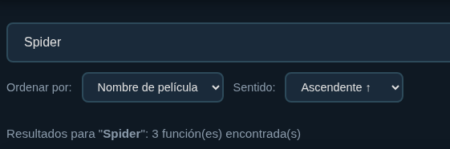

**Paso 2, confirmar la inyección:**

Probé este input en el campo de búsqueda:
```
' OR 1=1 --
```

La query resultante en el backend queda así:
```sql
... WHERE peliculas.nombre LIKE '%' OR 1=1 -- %' ORDER BY ...
```

El `--` comenta el resto de la línea (el `%'` sobrante y el `ORDER BY`), y `1=1` es una condición siempre verdadera. La aplicación devolvió **21 funciones**, prácticamente toda la tabla, a pesar de que ningún nombre real de película coincide con el string `' OR 1=1 --`. Esto confirma que el input se interpreta como código SQL y no como texto de búsqueda.

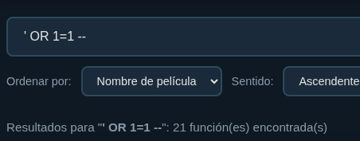

Capturé también el request HTTP crudo con Burp Suite (Proxy, HTTP History), que muestra el payload URL-encoded tal como llega al servidor:

```
GET /?buscar=%27+OR+1%3D1+--&ordenar_por=nombre&sentido=ASC HTTP/1.1
Host: localhost:5000
```

Donde `%27` es `'`, `+` es espacio y `%3D` es `=`. Se ve claramente cómo el parámetro `buscar` viaja sin ningún tipo de codificación/escape que impida la inyección.

### Mitigación aplicada

Modifiqué `buscar_funciones` en `Ejercicio1/app.py`:

- El valor de búsqueda (`query`) ahora se pasa como **parámetro bindeado** (`?`) en vez de concatenarse en el string SQL. SQLite trata ese valor siempre como dato literal, nunca como código, sin importar los caracteres que contenga.
- `sort_dir` se valida contra una **allowlist** (`"DESC"` o, por defecto, `"ASC"`) antes de insertarse en la query, ya que los placeholders `?` no aplican a palabras clave SQL como `ASC`/`DESC`.
- `sort_by` no requirió cambios: el ternario original ya solo puede resultar en dos valores fijos (`peliculas.nombre` o `funciones.fecha_hora`) independientemente del input, por lo que no era explotable.

```python
def buscar_funciones(query, sort_by='nombre', sort_dir='ASC'):
    db = get_db()

    columna_orden = 'peliculas.nombre' if sort_by == 'nombre' else 'funciones.fecha_hora'
    direccion = 'DESC' if sort_dir.upper() == 'DESC' else 'ASC'

    sql = (
        f"SELECT peliculas.nombre as pelicula, funciones.fecha_hora, "
        f"(funciones.asientos_totales - funciones.asientos_ocupados) as disponibles "
        f"FROM funciones "
        f"JOIN peliculas ON funciones.pelicula_id = peliculas.id "
        f"WHERE peliculas.nombre LIKE ? "
        f"ORDER BY {columna_orden} {direccion}"
    )
    return db.execute(sql, (f'%{query}%',)).fetchall()
```

**Verificación:** repetí el payload `' OR 1=1 --` después de aplicar el fix. La aplicación lo trata como texto literal de búsqueda: no encuentra ninguna película llamada así (0 resultados) en vez de las 21 funciones que devolvía antes.

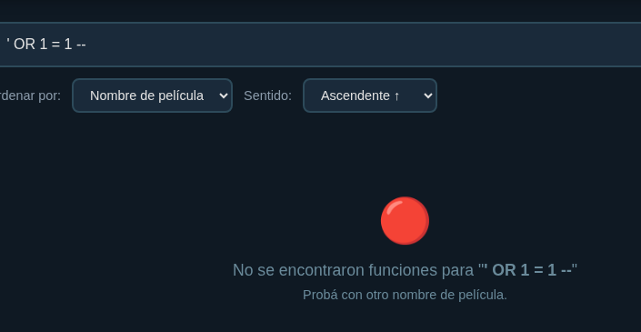

---

## Ejercicio 2 - Cross Site Scripting (XSS)

### Descripción de la vulnerabilidad

En `Ejercicio2/templates/edit.html`, la descripción de una película se renderiza con el filtro `| safe` de Jinja2:

```html
{{ pelicula['descripcion'] | safe }}
```

`| safe` desactiva el auto-escape que Jinja2 aplica por defecto a cualquier variable insertada en el HTML. Como `descripcion` se guarda sin ninguna sanitización (el endpoint `POST /edit/<id>` en `app.py` toma el valor del formulario tal cual y lo persiste en la base), cualquier usuario que edite una película puede inyectar HTML/JavaScript arbitrario, que se ejecuta cada vez que alguien visite esa página de edición (CWE-79, XSS almacenado / persistente).

El mismo dato (`descripcion`) se muestra también en `index.html` (el listado de resultados), pero **sin** `| safe`, y ahí Jinja2 sí escapa correctamente el contenido. Esto lo comprobé comparando las dos páginas: el problema es puntual, un único template desactivó explícitamente la protección por defecto.

### Impacto (qué pasa si se explota)

El script inyectado no se ejecuta en el navegador de quien lo escribió, sino en el navegador de cualquier otra persona que abra esa página de edición después, con la sesión y los permisos de esa persona. Esto permite, entre otras cosas:

- Robar su cookie de sesión (`document.cookie`) y enviarla a un servidor del atacante, para luego hacerse pasar por esa persona (session hijacking).
- Ejecutar acciones dentro de la app en nombre de la víctima (crear/borrar datos, lo que sea que su sesión tenga permitido).
- Redirigirla a un sitio de phishing o modificar visualmente la página para engañarla.

En la PoC usé `alert(document.cookie)` para demostrarlo de forma visible.

En vez de revisar archivo por archivo al azar, busqué en el código los patrones que típicamente indican que se desactivó una protección automática del framework. Jinja2 escapa por defecto, así que un XSS suele implicar que alguien lo apagó a propósito:

```bash
grep -rn "safe\|innerHTML\|dangerouslySetInnerHTML" .
```

Este comando me llevó directo a la línea 86 de `edit.html`. Después rastreé el origen del dato (`edit_post` en `app.py`) para confirmar que no pasa por ningún filtro de sanitización antes de guardarse.

### Prueba de Concepto (PoC)

**Entorno:** `docker-compose up --build` dentro de `Ejercicio2/`, app en `http://localhost:5000`.

**Paso 1:** busqué una película (`spider`) y entré a **Editar**.

**Paso 2:** en el campo **Descripción**, ingresé:
```html
<script>alert('XSS - ' + document.cookie)</script>
```
y guardé cambios.

**Paso 3:** al volver al buscador, la descripción se muestra como texto plano, escapada correctamente en `index.html`:

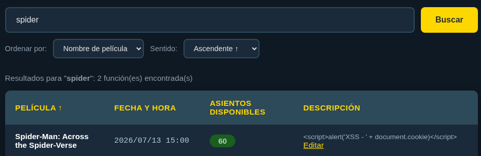

**Paso 4:** al volver a entrar a **Editar** esa misma película, el script se ejecuta, porque `edit.html` no escapa por el `| safe`:

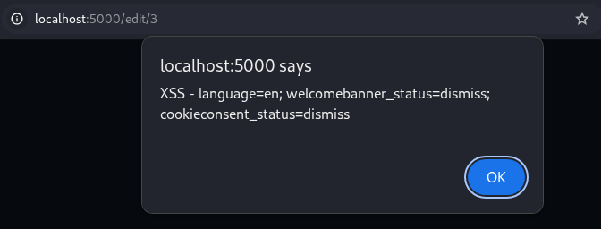

### Mitigación aplicada

En `Ejercicio2/templates/edit.html`, eliminé el filtro `| safe`:

```html
<!-- Antes -->
{{ pelicula['descripcion'] | safe }}

<!-- Después -->
{{ pelicula['descripcion'] }}
```

Con esto, Jinja2 vuelve a aplicar su auto-escape por defecto: cualquier `<`, `>`, `&`, etc. en la descripción se convierte a su entidad HTML (`&lt;`, `&gt;`, `&amp;`) antes de insertarse en la página, así que el navegador lo interpreta como texto a mostrar, no como código a ejecutar.

**Verificación:** repetí la PoC (guardar la misma descripción con el `<script>`) después del fix. Ya no dispara ningún `alert()`, el texto se muestra literalmente tanto en el listado como en la vista previa de edición.

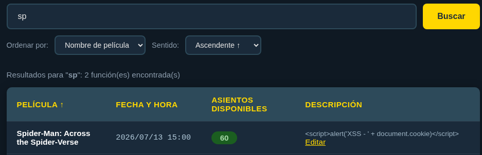
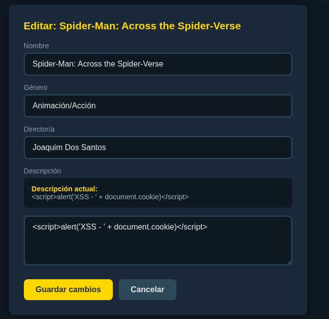

### Nota adicional: SQLi también presente en este ejercicio

`Ejercicio2/app.py` reutiliza la misma función `buscar_funciones` vulnerable a SQLi del Ejercicio 1 (ver esa sección para el detalle completo de la mitigación). Apliqué la misma técnica, parametrización con `?` más allowlist para `sort_dir`, adaptada a las columnas propias de este archivo (`descripcion`, `id` adicionales en el `SELECT`).

**Verificación:** repetí el payload `' OR 1=1 --` después del fix. Ya no devuelve resultados, antes devolvía todas las funciones.

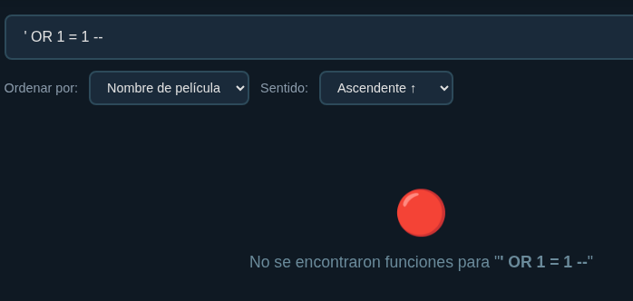

---

## Ejercicio 3 - File Upload

### Descripción de la vulnerabilidad

En `Ejercicio3/src/main/java/com/cinebuscador/controller/PeliculaController.java`, el endpoint `POST /upload/{id}` guarda el archivo subido usando el nombre original tal cual lo manda el cliente, sin ninguna validación:

```java
String filename = archivo.getOriginalFilename();
Path uploadPath = Paths.get(uploadDir);
...
Files.copy(archivo.getInputStream(), uploadPath.resolve(filename));
```

No hay ningún chequeo de extensión ni de `Content-Type` antes de guardar el archivo (CWE-434, Unrestricted Upload of File with Dangerous Type), así que se puede subir cualquier cosa (HTML, scripts, ejecutables) haciéndolo pasar por un "afiche".

### Impacto (qué pasa si se explota)

Al no exigir que sea una imagen, se puede subir un `.html` con JavaScript embebido. Como la app lo sirve con el `Content-Type` detectado automáticamente, al abrir la URL del archivo subido el navegador lo interpreta como HTML/JS y lo ejecuta, con el mismo impacto que un XSS (robo de cookies, acciones en nombre de la víctima), pero alcanzado subiendo un archivo en vez de inyectando en un campo de texto.

### Prueba de Concepto (PoC)

**Entorno:** `docker-compose up --build` dentro de `Ejercicio3/` (mapeé el puerto a `8081:8080` para no chocar con el proxy de Burp en `8080`), app en `http://localhost:8081`.

1. Creé un archivo malicioso: `echo '<script>alert("XSS via file upload - " + document.cookie)</script>' > /tmp/poc.html`
2. En la app, busqué una película, entré a "Cargar afiche", seleccioné `/tmp/poc.html` y subí el afiche. La app lo aceptó sin quejarse.
3. Accedí directo a `http://localhost:8081/uploads/poc.html` y el script se ejecutó.

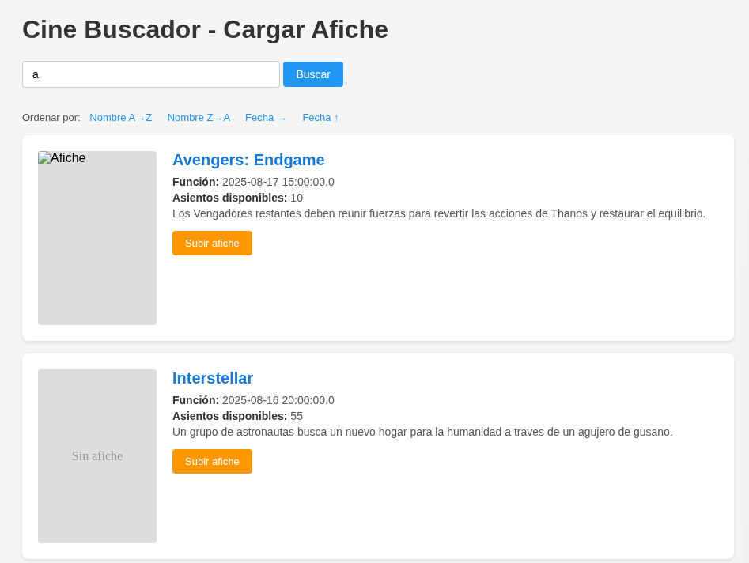
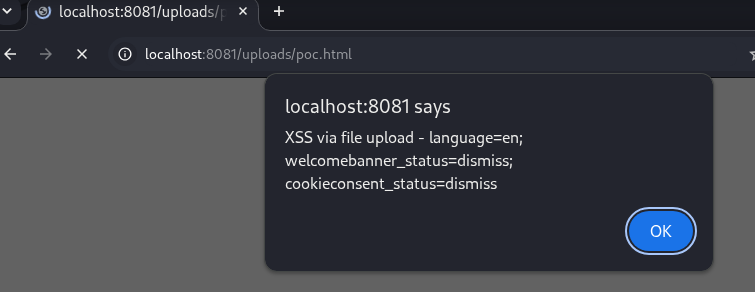

### Mitigación aplicada

Modifiqué `uploadFile` en `PeliculaController.java`:

**Antes:**
```java
@PostMapping("/upload/{id}")
public String uploadFile(@PathVariable Integer id,
                         @RequestParam("afiche") MultipartFile archivo) throws IOException {
    Pelicula pelicula = peliculaRepo.findById(id)
        .orElseThrow(() -> new EntityNotFoundException("Pelicula no encontrada"));

    String filename = archivo.getOriginalFilename();
    Path uploadPath = Paths.get(uploadDir);
    if (!Files.exists(uploadPath)) {
        Files.createDirectories(uploadPath);
    }
    Files.copy(archivo.getInputStream(), uploadPath.resolve(filename));

    pelicula.setAfichePath(filename);
    peliculaRepo.save(pelicula);

    return "redirect:/";
}
```

**Después:**
```java
private static final List<String> EXTENSIONES_PERMITIDAS = List.of(".jpg", ".jpeg", ".png", ".webp");

@PostMapping("/upload/{id}")
public String uploadFile(@PathVariable Integer id,
                         @RequestParam("afiche") MultipartFile archivo) throws IOException {
    Pelicula pelicula = peliculaRepo.findById(id)
        .orElseThrow(() -> new EntityNotFoundException("Pelicula no encontrada"));

    String nombreOriginal = archivo.getOriginalFilename();
    String extension = nombreOriginal != null && nombreOriginal.contains(".")
        ? nombreOriginal.substring(nombreOriginal.lastIndexOf('.')).toLowerCase()
        : "";

    if (!EXTENSIONES_PERMITIDAS.contains(extension)) {
        throw new IllegalArgumentException("Tipo de archivo no permitido");
    }

    String nombreSeguro = UUID.randomUUID() + extension;

    Path uploadPath = Paths.get(uploadDir);
    if (!Files.exists(uploadPath)) {
        Files.createDirectories(uploadPath);
    }
    Files.copy(archivo.getInputStream(), uploadPath.resolve(nombreSeguro));

    pelicula.setAfichePath(nombreSeguro);
    peliculaRepo.save(pelicula);

    return "redirect:/";
}
```

Agregué una allowlist de extensiones (`EXTENSIONES_PERMITIDAS`): antes de aceptar el archivo, valido que su extensión sea una de las permitidas para afiches. Cualquier otro tipo se rechaza con una excepción.

También cambié cómo se elige el nombre de archivo: ahora lo genera el servidor con `UUID.randomUUID()`, en vez de usar el nombre que manda el cliente, para no depender de un dato que viene de afuera.

**Verificación:**

Repetí la subida de `poc.html`. La app ahora la rechaza con un error 500, porque tira una excepción.

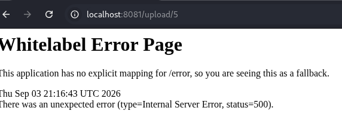

---

## Ejercicio 4 - Server Side Template Injection (SpEL Injection)

### Descripción de la vulnerabilidad

En `Ejercicio4/src/main/java/com/cinebuscador/config/SpelEvaluator.java`, el texto de búsqueda se evalúa directamente como una expresión de Spring Expression Language (SpEL):

```java
ExpressionParser parser = new SpelExpressionParser();
StandardEvaluationContext standardContext = new StandardEvaluationContext();
standardContext.setVariable("system", System.class);
standardContext.setVariable("runtime", Runtime.class);
var expr = parser.parseExpression(expression);   // expression = input del usuario
Object result = expr.getValue(standardContext);
```

El código incluso arma un `SimpleEvaluationContext` (la versión restringida y segura de SpEL), pero no lo usa. Evalúa la expresión con `standardContext`, que permite acceso irrestricto a reflection, clases del sistema y ejecución de código Java arbitrario (CWE-1336, Server-Side Template Injection).

### Impacto (qué pasa si se explota)

`StandardEvaluationContext` no pone ningún límite a qué se puede hacer dentro de la expresión evaluada. Permite instanciar objetos, invocar métodos estáticos de cualquier clase del classpath con el operador `T(...)` de SpEL, y en consecuencia ejecutar comandos del sistema operativo a través de la API estándar de Java para procesos (`Runtime.getRuntime().exec(...)`). Esto es Remote Code Execution (RCE): el atacante no solo lee datos, ejecuta código con los mismos permisos que el proceso de la aplicación.

### Prueba de Concepto (PoC)

**Entorno:** `docker-compose up --build` dentro de `Ejercicio4/` (puerto mapeado a `8081:8080`), app en `http://localhost:8081`.

**Paso 1, confirmar que el input se evalúa como código:**

Busqué `2*3`. El mensaje mostró "Resultados buscando por: 6": el input no se trató como texto de búsqueda, se evaluó como una expresión matemática.

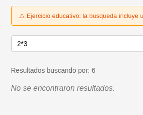

**Paso 2, escalar a ejecución de comandos (RCE):**

Busqué:
```
T(java.lang.Runtime).getRuntime().exec('touch /tmp/pwned_ssti')
```

El resultado fue `Process[pid=55, exitValue=0]`, es decir que el comando se ejecutó sin error.

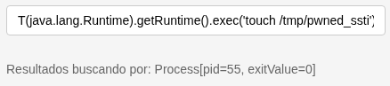

El `exitValue=0` que devuelve la propia app confirma que el comando se ejecutó sin error en el servidor, ejecución de comandos arbitrarios a través de un simple texto de búsqueda.

### Mitigación aplicada

Modifiqué `FuncionController.search` para dejar de evaluar el input de búsqueda como código. No hay forma segura de sanitizar un input para pasarlo a un parser de expresiones y que siga siendo útil como texto de búsqueda, son objetivos incompatibles, así que elimino el paso de evaluación por completo.

**Antes:**
```java
String spelResultado = spelEval.evaluate(buscar);
model.addAttribute("spelOutput", spelResultado);

if (!spelResultado.isBlank()) {
    List<Funcion> resultados = funcionRepo.findAll().stream()
        .filter(f -> f.getNombreFuncion() != null &&
                     f.getNombreFuncion().toLowerCase().contains(spelResultado.toLowerCase()))
        .collect(Collectors.toList());
    model.addAttribute("resultados", resultados);
    model.addAttribute("mensaje", "Resultados buscando por: " + spelResultado);
} else {
    model.addAttribute("resultados", new ArrayList<Funcion>());
    model.addAttribute("mensaje", "No se encontraron coincidencias.");
}
```

**Después:**
```java
List<Funcion> resultados = funcionRepo.findAll().stream()
    .filter(f -> f.getNombreFuncion() != null &&
                 f.getNombreFuncion().toLowerCase().contains(buscar.toLowerCase()))
    .collect(Collectors.toList());
model.addAttribute("resultados", resultados);
model.addAttribute("mensaje", "Resultados buscando por: " + buscar);
```

`buscar` se usa directamente como texto a comparar (`.contains(...)`), nunca se le pide a ningún parser que lo interprete como código. También eliminé la dependencia `SpelEvaluator` del controlador (campo, parámetro del constructor e import), al quedar sin uso.

**Verificación:** repetí los dos payloads de la PoC después del fix. Ambos se tratan ahora como texto literal de búsqueda, 0 resultados, ya que ninguna función se llama igual que esos strings.

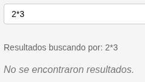
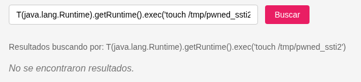

---

## Ejercicio 5 - Almacenamiento inseguro

### Descripción de la vulnerabilidad

En `Ejercicio5/src/main/java/com/cinebuscador/config/EncryptionService.java` las contraseñas de los usuarios se cifran, no se hashean, con AES, con dos problemas graves en cómo está implementado:

```java
private static final String SECRET_KEY = "MySup3rS3cr3tK3y!2024CineBuscadorAES";
...
private static final String CIPHER_ALGO = "AES/ECB/PKCS5Padding";
```

1. Clave hardcodeada en el código fuente (CWE-798, Use of Hard-coded Credentials): la clave de cifrado está escrita como texto plano en el `.java`. Cualquiera con acceso al código, o al `.jar` compilado, que se descompila trivialmente, tiene la clave para descifrar todas las contraseñas de todos los usuarios sin romper nada criptográficamente, la clave ya está ahí.
2. Modo ECB, determinístico (CWE-327, Broken/Risky Crypto): AES en modo ECB cifra cada bloque de forma independiente, sin un vector de inicialización (IV) aleatorio. El mismo texto plano siempre produce el mismo texto cifrado, filtrando qué usuarios comparten contraseña, sin necesidad de descifrar nada.

El diseño de fondo también es incorrecto, más allá de estos dos bugs: las contraseñas se cifran de forma reversible en vez de hashearse. Un sistema de autenticación nunca necesita poder recuperar la contraseña original, solo necesita verificar que la que ingresó el usuario es la correcta.

### Impacto (qué pasa si se explota)

Con la clave hardcodeada, un atacante que obtenga acceso al código fuente o al backup de la base de datos puede descifrar todas las contraseñas de todos los usuarios instantáneamente, sin ataques de fuerza bruta ni de diccionario.

Con ECB, incluso sin la clave, se puede detectar qué usuarios comparten contraseña comparando los valores cifrados almacenados, información sensible por sí sola.

### Prueba de Concepto (PoC)

**Entorno:** `docker-compose up --build` dentro de `Ejercicio5/` (puerto mapeado a `8081:8080`), app en `http://localhost:8081`.

**Parte 1, confirmar el determinismo de ECB (en vivo, vía la web):**

1. Registré a `usuario1` con contraseña `MismaClave123`, inicié sesión y la app mostró la contraseña cifrada: `kGyi01UIKhEIYesIBN2IGA==`.

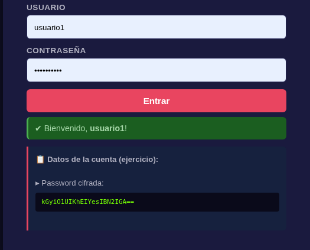

2. Registré a `usuario2` con la misma contraseña, inicié sesión, y la contraseña cifrada dio idéntica: `kGyi01UIKhEIYesIBN2IGA==`.

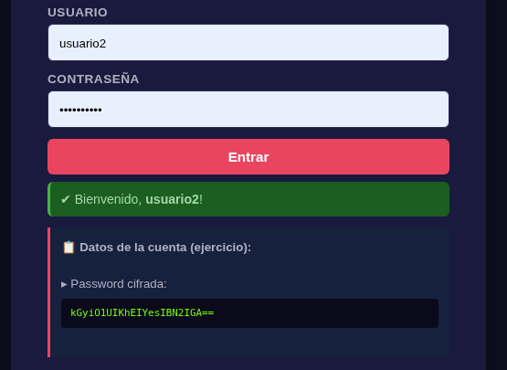

Dos usuarios distintos, con la misma contraseña, produjeron exactamente el mismo texto cifrado. Confirma que el cifrado es determinístico y filtra esa coincidencia sin que haga falta descifrar nada.

**Parte 2, clave hardcodeada (evidencia de código fuente):**

Esta parte no requiere una request HTTP, el propio código fuente es la prueba. El archivo `EncryptionService.java` contiene, en texto plano:

```java
private static final String SECRET_KEY = "MySup3rS3cr3tK3y!2024CineBuscadorAES";
```

y además expone métodos que devuelven la clave cruda:

```java
public static String getStaticKey() { return SECRET_KEY; }
public static byte[] getKeyBytes() { return secretKey.getEncoded(); }
public static String getKeyHex() { ... }
```

Cualquiera con acceso al repositorio obtiene la clave de forma directa, no hay que romper ningún cifrado, la clave está escrita ahí.

### Mitigación aplicada

Opté por el fix de fondo en vez de un parche puntual de los 2 bugs: pasar de cifrado reversible a hash con salt (BCrypt). Un sistema de login nunca necesita recuperar la contraseña original, solo verificar que la ingresada es correcta.

**Cambios:**

1. En `pom.xml`, agregué la dependencia `spring-security-crypto` (solo las utilidades de hash, no todo el framework de seguridad):
   ```xml
   <dependency>
       <groupId>org.springframework.security</groupId>
       <artifactId>spring-security-crypto</artifactId>
   </dependency>
   ```

2. En `AuthController.java`, reemplacé `EncryptionService` por `BCryptPasswordEncoder`:

   **Antes (registro):**
   ```java
   nuevoUsuario.setPassword(EncryptionService.encrypt(password));
   ```
   **Después:**
   ```java
   nuevoUsuario.setPassword(passwordEncoder.encode(password));
   ```

   **Antes (login):**
   ```java
   String decryptedPassword = EncryptionService.decrypt(user.getPassword());
   if (password.equals(decryptedPassword)) { ... }
   ```
   **Después:**
   ```java
   if (user != null && passwordEncoder.matches(password, user.getPassword())) { ... }
   ```

3. Borré por completo `EncryptionService.java` (clave hardcodeada, modo ECB y los métodos que exponían la clave cruda).

4. En `index.html`, actualicé la etiqueta de "Password cifrada" a "Password (hash BCrypt)", reflejando el cambio real.

Este único cambio resuelve las 2 vulnerabilidades a la vez. La clave hardcodeada desaparece porque ya no existe ninguna clave secreta en el sistema, BCrypt genera un salt aleatorio distinto para cada contraseña, embebido en el propio hash resultante. El determinismo de ECB desaparece por el mismo motivo: al haber un salt aleatorio distinto en cada hash, la misma contraseña genera un resultado distinto cada vez, incluso para dos usuarios distintos.

**Verificación:** repetí la Parte 1 de la PoC (dos usuarios con la misma contraseña) después del fix. Los hashes resultantes ahora son distintos entre sí, a pesar de compartir la misma contraseña:

- `usuario1` da `$2a$10$mQWOIUn3UMZsPGpRuLID7.264LF8MlQGKUsH.exySMSCXIaw37aky`
- `usuario2` da `$2a$10$u7DFPwOVft7wunsRqD920./LK8zH3j0mqHyM0ErT3OIf51vPllWvy`

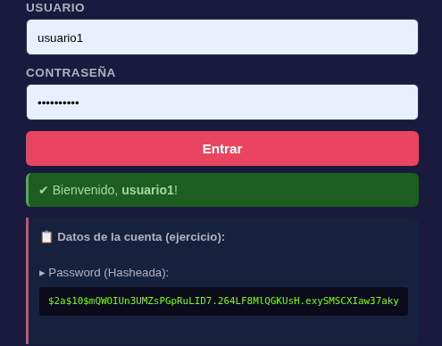
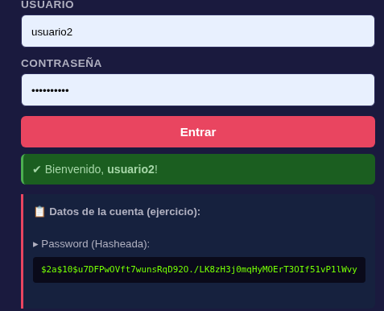

El prefijo `$2a$10$...` confirma que se está usando BCrypt (versión `2a`, costo `10`). Ya no hay ningún patrón detectable entre contraseñas iguales, y no existe ninguna clave capaz de revertir estos valores a texto plano.


---

## Cómo correr los tests (Práctico 4)

> **Disclaimer:** Los tests fueron escritos y ejecutados por mí, en mi propia máquina virtual, para las dos ramas (`main` y `practico-2`). Conté con asistencia de una herramienta de IA para la ayuda en la estrucutra de los tests, resolver problemas de configuración (Maven, versiones de Java, Docker) y redactar esta sección.

Agregué pruebas automatizadas para cada vulnerabilidad del Práctico 2, que confirman que la mitigación sigue funcionando (y que fallarían si alguien reintrodujera el bug sin querer). Tienen que fallar en `main` y pasar acá en `practico-2`.

### Ejercicio 1 - SQLi (Pytest)

```bash
cd Ejercicio1
python3 -m venv .venv
source .venv/bin/activate
pip install -r requirements-dev.txt
pytest tests/ -v
```

### Ejercicio 2 - XSS (Pytest)

```bash
cd Ejercicio2
python3 -m venv .venv
source .venv/bin/activate
pip install -r requirements-dev.txt
pytest tests/ -v
```

### Ejercicio 3 - File Upload (prueba de integración, necesita Docker levantado)

```bash
cd Ejercicio3
docker-compose up --build -d
python3 -m venv .venv
source .venv/bin/activate
pip install -r requirements-dev.txt
pytest tests/ -v
```

### Ejercicio 4 - SSTI (prueba de integración, necesita Docker levantado)

```bash
cd Ejercicio4
docker-compose up --build -d
python3 -m venv .venv
source .venv/bin/activate
pip install -r requirements-dev.txt
pytest tests/ -v
```

### Ejercicio 5 - Almacenamiento inseguro (JUnit)

```bash
cd Ejercicio5
mvn test
```
